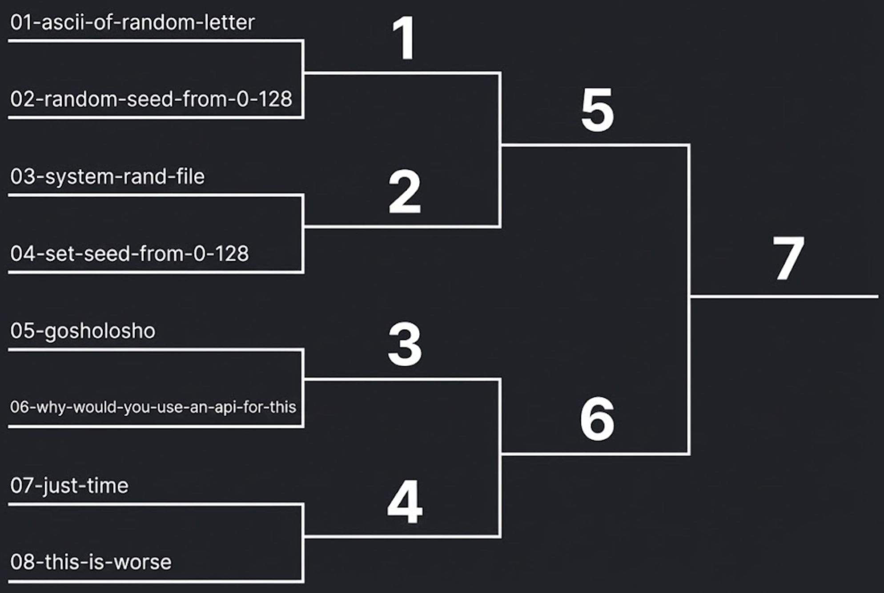

# Задача 1 - `tournament` (300 точки)

- Целта на задачата е да се реализира турнир между процеси, които генерират случайни числа.

- В папката `./gladiators` ще намерите 8 програми, всяка от които по един или друг начин генерират случайни числа.
  - Случайните числа ВИНАГИ се връщат като status code на програмата, т.е. чрез return в края на изпълнението им.
  - `./gladiators/src` съдържа изходния код на програмите, а `./gladiators/bin` - компилираните им версии, след изпълнение на `make` командата.
  - Две от програмите изискват позиционни аргументи (конкретно `01-ascii-of-random-letter` и `04-set-seed-from-0-128`), другите могат да се извикат без аргументи.
  - Някои от програмите принтират на стандартния изход или на стандартната грешка, но нито една от програмите не очаква стандартен вход.
  - Пример за изпълнението на някои от програмите:
    ```bash
    bash-3.2$ cd gladiators/bin
    bash-3.2$ ./04-set-seed-from-0-128 73570880
    bash-3.2$ echo $? # <- връща return кода на последната команда
    68

    bash-3.2$ ./07-why-would-you-use-an-api-for-this 
    --- Connecting to an API for a single integer ---
    ---         (why would one do this?!?)        ---
    Connected! Requesting randomness...

    --- SERVER RESPONSE ---
    Your Random Number is: 98.
    -----------------------
    bash-3.2$ echo $? # <- връща return кода на последната команда
    98 

    ```

- За целите на задачата е нужно да направите single-elimination турнир (т.е. при една загуба се отпада от турнира), в който ще се проведат 7 мача:
  - 4 четвъртфинала (мачове 1, 2, 3 & 4)
  - 2 полуфинала (мачове 5 & 6)
  - 1 финал (мач 7)

- За референция можете да използвате следната графика:
  

- Всеки от мачовете трябва да се изпълнява един след друг, като след края на всеки мач паузирате за 1 секунда посредством `sleep()`.

- След всеки мач трябва да се изпише резултата му.

- НЕ може да се преизползва числото генерирано от предходен мач за настоящ такъв - във всеки мач трябва наново да изпълни двете програми.

- За програмите, които изискват командни аргументи, може да използвате произволни такива, каквито прецените.

- При равен резултат между 2 процеса (рядко, но се случва), избирайте първия да продължи.

- След приключване на работата на създаден процес, родителския процес задължително трябва да провери статуса му на завършване.

- За реализцията на програмата трябва да използвате системните функции `fork`, `waitpid` и функция/и от семейството функции `exec`.

- Задължително трябва да обработвате грешки при системните извиквания.

- Бонус условие (15 точки): Ако има равенство, мачът да се преиграва.

- Бонус условие (35 точки): Ако програмата ви се извика по следния начин:
  ```bash
  ./tournament --bo3
  ```
  тогава нека всички мачове се играят като най-добър от 3 - т.е. печели процесът първи достигнал 2 победи.
